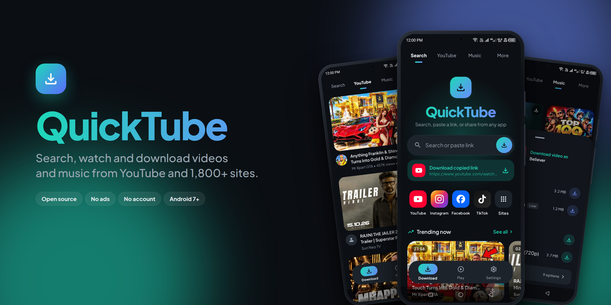
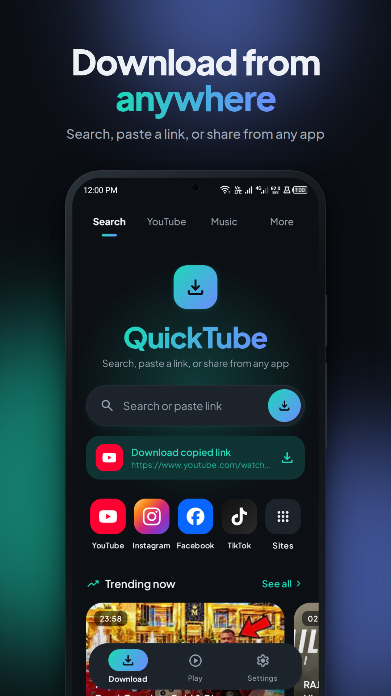
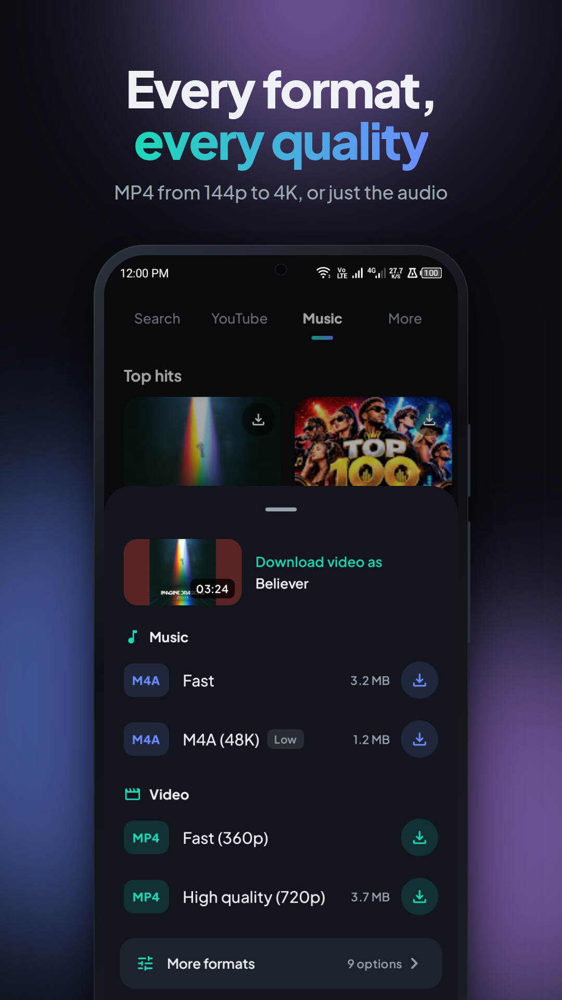
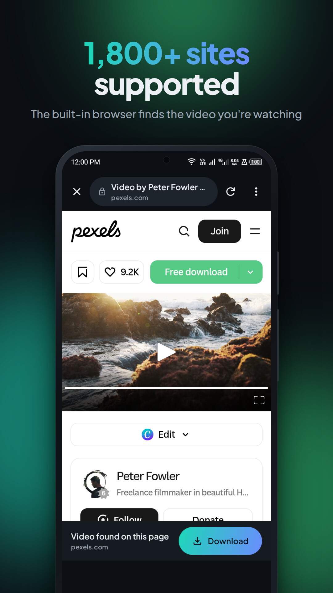
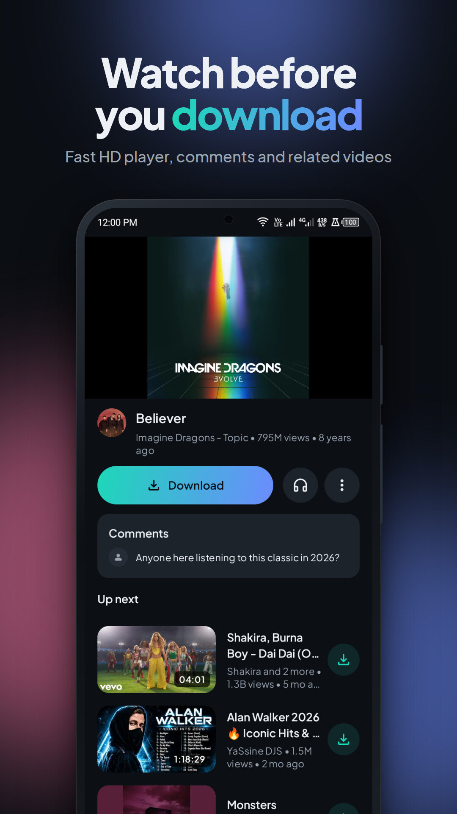
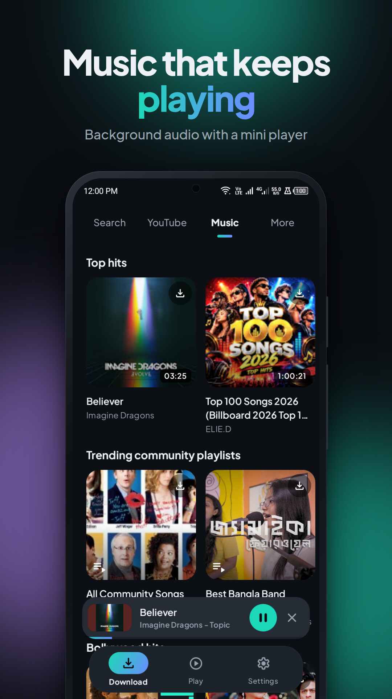
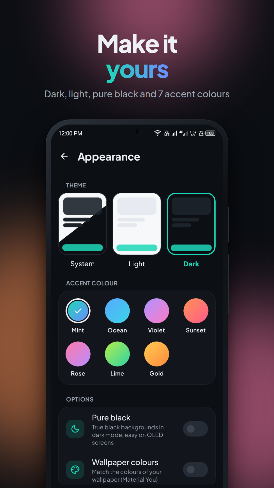
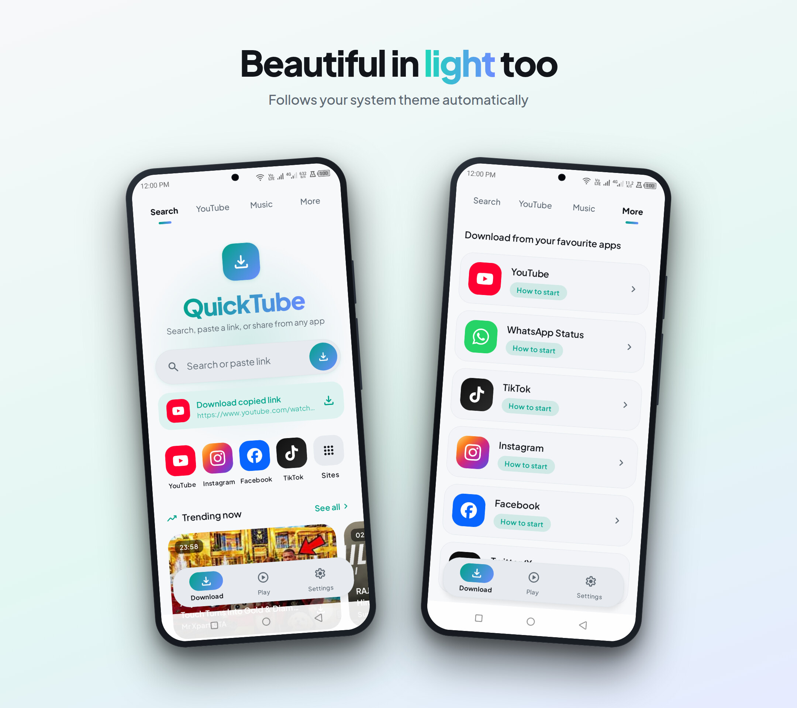

<div align="center">



# QuickTube

**Search, watch and download videos and music from YouTube and 1,800+ sites. Open source, no ads, no account.**

[](https://github.com/devgalib/QuickTube/actions/workflows/ci.yml)
[](https://github.com/devgalib/QuickTube/releases/latest)
[](LICENSE)


[**Download the latest APK**](https://github.com/devgalib/QuickTube/releases/latest) · [Report a bug](https://github.com/devgalib/QuickTube/issues/new/choose) · [Contribute](CONTRIBUTING.md)

</div>

> [!IMPORTANT]
> Only download content you own or have permission to save, and respect each site's terms of service.
> QuickTube doesn't bypass DRM and isn't affiliated with YouTube, Google or any other site.

## Screenshots

<table>
  <tr>
    <td></td>
    <td></td>
    <td></td>
  </tr>
  <tr>
    <td></td>
    <td></td>
    <td></td>
  </tr>
</table>



## Install

1. Open the [latest release](https://github.com/devgalib/QuickTube/releases/latest) on your phone and download
   `QuickTube-vX.Y.Z-arm64-v8a.apk` (almost every phone from the last 8 years), `…-armeabi-v7a.apk` for older 32-bit phones,
   or the larger `QuickTube-vX.Y.Z.apk` that runs on both.
2. Open it and allow "Install unknown apps" for your browser when Android asks.
3. Optional: check the file against the `.sha256` next to it.

Releases are signed with the same key every time, so updates install over the previous version. After the first install,
QuickTube tells you when a new version is out and can update itself (Settings → Check for updates).

## Features

| Area | What it does |
|---|---|
| **Download tab** | *Search*: search box, "download copied link" chip, quick sites. *YouTube*: regional trending feed (music, gaming, movies, podcasts, live mixed). *Music*: song and playlist rows. *More*: per-platform "How to download" guides. |
| **Search** | Live suggestions, recent searches, hot searches, results with All / Videos / Playlist / Channels / Music filters, plus Google / TikTok / Facebook / Instagram web search. |
| **Video page** | Inline 720p player, Download button, play-in-background (audio only), About sheet (likes, share, watch later), comments, "Up next". Channel and playlist pages. |
| **Playlists & channels** | **Download all**, or **Select** videos (with select all) and download them together, or download one by one. One quality for the batch (M4A / 360p / 720p / 1080p / best); each video gets its closest format, in the background. |
| **Download sheet** | "Download video as" with Music (M4A / Opus) and Video (144p–4K) choices, plus a *More formats* page. Video-only streams are merged with audio on-device (no re-encoding). |
| **Share to download** | "Download with QuickTube" appears in every app's share sheet. The format picker pops up over YouTube, Facebook, TikTok and other apps, and the download continues in the background. |
| **Browser** | Built-in WebView for any site. On a video page a Download bar appears under the page (even before you press play) from the page's own player data; on listing pages it stays hidden. It offers every quality the page has, plus an audio-only M4A. Pasting or sharing a link opens the download sheet directly. This works with plain MP4 players, HLS (`.m3u8`, including AES-128 encrypted) behind `blob:` players, iframe-embedded players and shadow-DOM players. HLS is converted to MP4 on the phone. YouTube videos open the native page. Sites list (add/delete), history, saved pages. |
| **Download engine** | Each file is split into 4 MB pieces fetched over up to 8 connections at once, and video and audio download together. Pieces are remembered, so pause, retry or even a killed app resume where they were. Merging runs in-process with Media3 on private storage (a 10-minute 720p video takes a few seconds). Formats are chosen by codec so they can always be saved (H.264 first, AV1 only on Android 14+, VP9 as WebM); if a site still serves one that can't, or a link expires, the page is re-extracted and the download carries on. Queue, Wi-Fi vs mobile task limits, speed limit, notifications. |
| **Play tab** | Downloading card, downloaded list with filter (music / video / pictures), search, multi-select (share, vault, delete). Item menu: vault, play as audio, convert to audio, share, open with, rename, delete. Remembers playback position. |
| **Player** | Speed, previous / next, seek, double-tap ±10 s, fullscreen landscape, "All videos" queue, Listen (audio-only) mode, shuffle / repeat, mini player, lock-screen and notification controls. |
| **In-app updates** | New releases are announced inside the app with their release notes. One tap downloads, verifies (SHA-256 and the same signing key) and installs the update; Android asks once for the "install unknown apps" permission. |
| **Settings** | Download path, max tasks, speed limit, mobile data, notification toggles, **Appearance** (System/Light/Dark, 7 accent palettes, pure-black AMOLED, Material You wallpaper colours on Android 12+), content region, feedback, share, about. |
| **Tools** | Recycle bin (30-day recover), deleted download history with "Download again", WhatsApp status saver, PIN-locked Vault, storage clean, large files clean, app uninstaller. |

## Site support

Extraction runs in three layers, cheapest first:

1. **NewPipe Extractor**: YouTube, SoundCloud, Bandcamp (native pages, fastest).
2. **Page reader** (`PageMediaParser` + `StreamResolver`): reads the player data the page ships with (quality lists, HLS playlists,
   JSON-LD, Open Graph) from the live WebView, using the user's session.
3. **yt-dlp** (`core:ytdlp`, bundled Python): about 1,800 site extractors, updated daily straight from the yt-dlp release URL.

On-device check against yt-dlp's own example URLs for 118 popular sites (`SiteSupportTest`):

```bash
./gradlew :app:connectedDebugAndroidTest -Pandroid.testInstrumentationRunnerArguments.class=com.edureminder.quicktube.SiteSupportTest
```

End-to-end check of the real share flow on a release build (R8 and resource shrinking on, like a published
APK): `scripts/share_bot.py` sends each link the way an app's Share button does, picks a format in the sheet,
waits for the download and checks the file with ffprobe and a full ffmpeg decode. Put one `name<TAB>url` per line
in a text file (copy links with each app's Share → Copy link):

```bash
./gradlew :app:installQa
```

```bash
python3 scripts/share_bot.py links.txt --fresh --report bot-report.json
```

Last run: 34/118 downloaded end to end. Failures broke down as: dead or removed example links (17), region/IP blocks (13),
login-only (7, which work in the in-app browser once signed in), DRM/DASH-only/live (7), sites whose yt-dlp extractor was
broken that day (18, fixed by its updates), and network/other (12).

## Design

- Font: Plus Jakarta Sans (SIL OFL), bundled in `core/designsystem/src/main/res/font`.
- Icons: Google Material Symbols (Rounded) and Simple Icons brand logos, generated into
  `core/designsystem/.../icon/QtIcons.kt` by `scripts/gen_icons.py`. To add an icon, add it to the table there and re-run:

```bash
python3 scripts/gen_icons.py /tmp/qt-icons core/designsystem/src/main/java/com/edureminder/quicktube/core/designsystem/icon/QtIcons.kt
```

- Touch feedback: `Modifier.pressable()` (spring press-scale, accent ripple, optional haptics). Loading: `Modifier.shimmer()` skeletons.

## Permissions by Android version

| Permission | When it's asked |
|---|---|
| Storage (write) | Android 7–10 only, at first launch and again just before a download if it was denied |
| Notifications | Android 13+, at first launch; Settings → Notifications shows an "Allow" banner if it's off |
| Photos/videos/audio | Android 13+ (partial access handled on 14+); storage read on 12 and older. Only for Large files clean |
| Storage (read) | Android 10 and older, for WhatsApp status saver; Android 11+ uses the system folder picker instead |

## Build from source

```bash
./gradlew :app:installDebug
```

```bash
./gradlew testDebugUnitTest
```

Release-optimised build for testing on a device (R8 on, signed with the debug key, installs next to the debug app):

```bash
./gradlew :app:installQa
```

Live extractor tests (hit the network) only run when asked:

```bash
NETWORK_TESTS=1 ./gradlew :core:extractor:testDebugUnitTest
```

See [docs/ARCHITECTURE.md](docs/ARCHITECTURE.md) for the module layout and how to add a feature.

## Known limits

- **MP3**: Android has no built-in MP3 encoder, so audio comes out as M4A (AAC) or Opus. Both play everywhere MP3 does.
  True MP3 needs a native encoder (e.g. LAME) added as a library.
- **DRM**: DRM-protected streams (Widevine, as used by Netflix and paid platforms) and DASH-only players can't be downloaded.
- **Facebook / Instagram**: public videos work from shared links and from the browser. Private or login-only posts need you
  to sign in inside the QuickTube browser first.
- Not replicated: SnapTube's "Boost" and "Battery saver", which don't do anything real on modern Android, plus its ads and
  account sign-in. Storage clean, large files clean and the app uninstaller are implemented for real.
- **Store policy**: Google Play and the App Store don't allow apps that download YouTube videos. Ship through other channels
  (direct APK, alternative stores) or remove the YouTube download path before submitting.
- **License**: NewPipe Extractor is GPLv3, so distributing this app means distributing it under GPL-compatible terms.

## Contributing

Contributions are welcome! Read [CONTRIBUTING.md](CONTRIBUTING.md) to get started, and the [Code of Conduct](CODE_OF_CONDUCT.md).
All changes go through pull requests to `main`; releases are published by the maintainer (see [docs/RELEASING.md](docs/RELEASING.md)).

## Privacy

No accounts, no servers of our own. Official releases send crash reports and anonymous usage counts through Firebase, and you can
turn that off in Settings → Privacy. Details in [PRIVACY.md](PRIVACY.md).

## Credits

- [NewPipe Extractor](https://github.com/TeamNewPipe/NewPipeExtractor) (GPL-3.0): YouTube support
- [yt-dlp](https://github.com/yt-dlp/yt-dlp) (Unlicense) via [youtubedl-android](https://github.com/yausername/youtubedl-android) (GPL-3.0): site support
- AndroidX (Compose, Media3, Room, Navigation, DataStore), Koin, Coil, OkHttp (Apache-2.0)
- [Material Symbols](https://fonts.google.com/icons) (Apache-2.0), [Simple Icons](https://simpleicons.org) (CC0), [Plus Jakarta Sans](https://github.com/tokotype/PlusJakartaSans) (OFL-1.1)

## License

QuickTube is free software: you can redistribute it and/or modify it under the terms of the
[GNU General Public License v3.0 or later](LICENSE).
